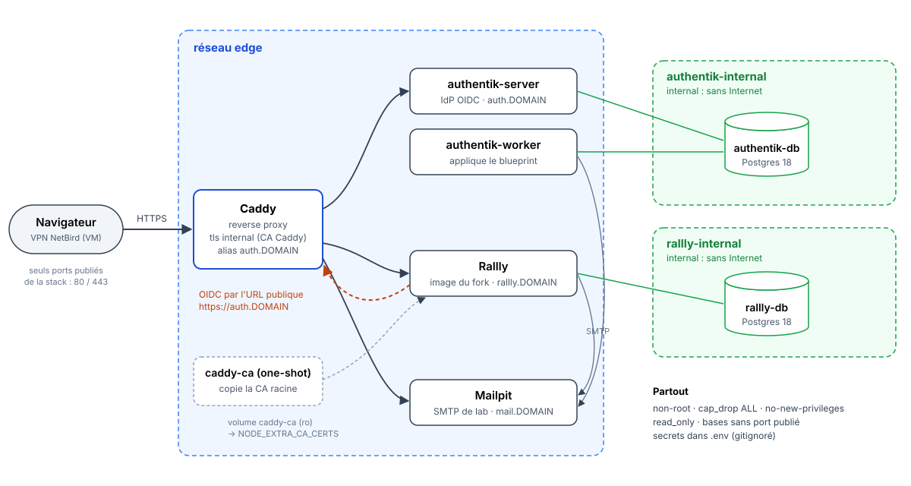
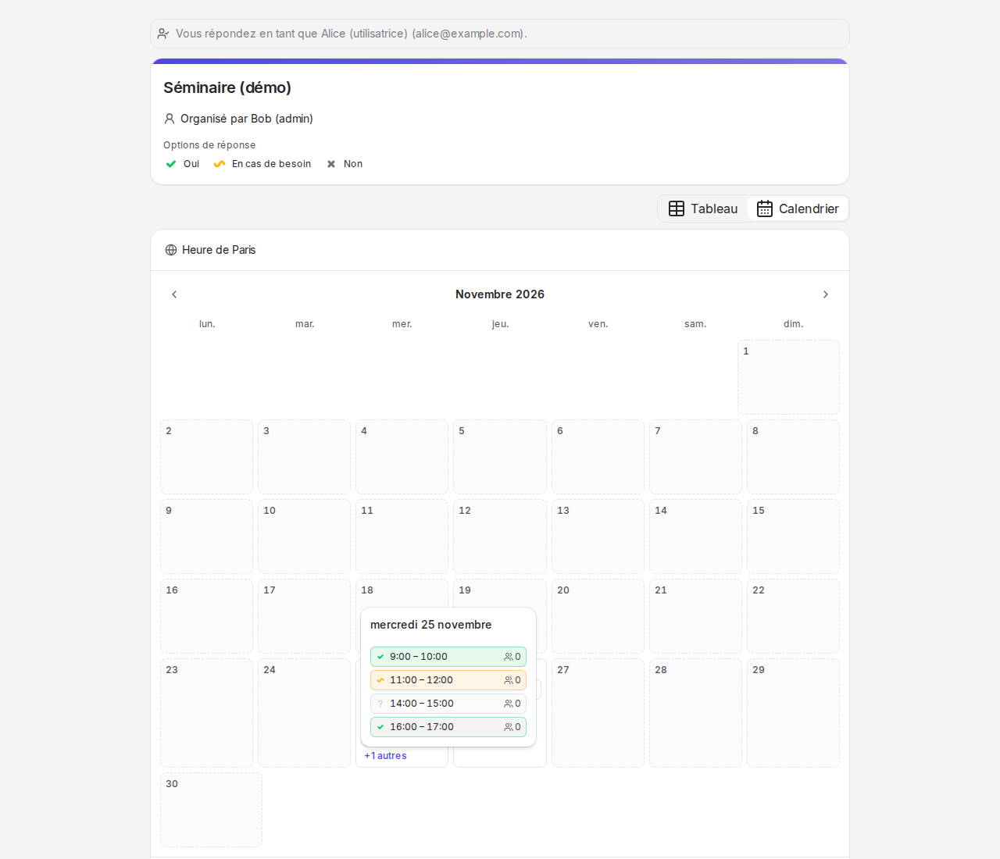
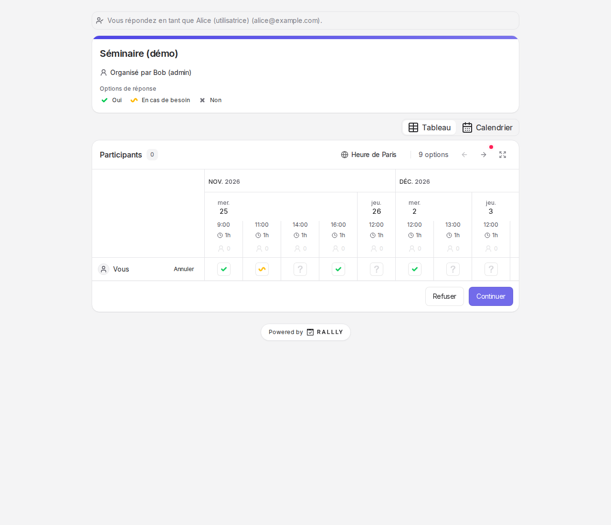

# projet-infra

Projet M2 « Dev avec Docker » : un environnement local **et** sur VM, derrière un reverse proxy, avec
**Authentik** comme fournisseur d'identité (OIDC) et **Rallly** (sondages de dates) comme application.

- Code des features Rallly : fork https://github.com/les-salopards/rallly (l'image est destinée à GHCR, publiée par la CI du fork).
- Ce dépôt : la stack Compose, la configuration Authentik (déclarative), le déploiement sur la VM, le durcissement et le scan.

## Démarrage

Prérequis : Docker Engine 24+ avec le plugin Compose v2, ports 80 et 443 libres, ~5 Go de disque (images : ~3,8 Go), 4 Go de RAM libres.

```sh
git clone https://github.com/les-salopards/projet-infra.git && cd projet-infra
./scripts/init-env.sh          # crée .env avec des secrets aléatoires (DOMAIN=localhost)
docker compose up -d --wait    # ~2 min au premier lancement
```

| URL | Service |
| --- | --- |
| https://rallly.localhost | Rallly (connexion uniquement via Authentik) |
| https://auth.localhost | Authentik (admin : `akadmin` / `AUTHENTIK_BOOTSTRAP_PASSWORD` du `.env`) |
| https://mail.localhost | Mailpit (SMTP de lab : e-mails envoyés par Rallly et Authentik) |

Les certificats viennent de la CA interne de Caddy : le navigateur affiche un avertissement.
Pour l'éviter, importer la CA dans le magasin de certificats du poste :
`docker compose cp caddy:/data/caddy/pki/authorities/local/root.crt caddy-root.crt`.

Par défaut, Rallly tourne avec l'image officielle (`lukevella/rallly:4.17`), qui ignore nos features.
Pour la démo des features : `RALLLY_IMAGE=ghcr.io/les-salopards/rallly:latest` dans le `.env` (image publiée par la CI
du fork à chaque merge sur `main`), puis `docker compose up -d`.

Vérifier que tout est sain :
```sh
docker compose ps                           # tout healthy, caddy-ca en "exited (0)"
docker compose logs rallly | grep -i oidc   # pas de "Provider ... skipped"
./scripts/scan.sh                           # CVE, règles de durcissement, secrets (voir docs/security.md)
```

### Comptes de démo
Mot de passe = `DEMO_PASSWORD` du `.env` (`grep ^DEMO_PASSWORD= .env`).

| Compte | Groupe | Rallly |
| --- | --- | --- |
| `alice` | `rallly-users` | autorisé |
| `bob` | `rallly-admins` (admin Authentik) | autorisé |
| `charlie` | aucun | refusé par Authentik |

## Architecture



| Élément | Choix |
| --- | --- |
| Point d'entrée | Caddy, seul service à publier des ports (80 → 443). Une application = un bloc dans [`caddy/Caddyfile`](caddy/Caddyfile). |
| TLS | CA interne de Caddy (`tls internal`) : pas d'IP publique, ni en local ni sur la VM. |
| OIDC | Rallly joint Authentik **par la même URL que le navigateur** (`https://auth.<DOMAIN>`) : alias réseau sur Caddy + CA de Caddy fournie à Node par `caddy-ca`. |
| Bases | Deux Postgres sur des réseaux `internal`, sans port publié. |
| Volumes | `caddy-data` (CA, certificats), `caddy-config`, `caddy-ca` (certificat racine seul), `authentik-db`, `authentik-data`, `rallly-db`. |
| Config Authentik | 100 % déclarative : [`authentik/blueprints/rallly.yaml`](authentik/blueprints/rallly.yaml), appliquée par le worker. |
| Secrets | Uniquement dans `.env` (gitignoré, `chmod 600`), jamais dans les images ni dans le dépôt. |

## Local et VM

Le **même `compose.yml`** tourne sur le poste et sur la VM Énov ; seuls le `.env` et `DOMAIN` changent
(`localhost` en local, `<IP-avec-tirets>.sslip.io` sur la VM). La VM ne build rien : elle tire l'image du fork depuis GHCR.
Mise en place, écarts et accès formateur : [docs/vm.md](docs/vm.md).

## Authentik : SSO, policies, invitation
- **SSO** : connexion à Rallly uniquement via Authentik (`EMAIL_LOGIN_ENABLED=false`).
- **Policies par groupe** : `rallly-users` et `rallly-admins` ont accès, tout autre compte est refusé par Authentik avant Rallly.
- **Invitation externe** : lien à usage unique → inscription → groupe `rallly-users`.

Détails, captures et scénarios de démo : [docs/authentik.md](docs/authentik.md).

## Features Rallly (fork)

| Feature | Type | Spec et preuves | Activation |
| --- | --- | --- | --- |
| Vote verrouillé par OAuth | catalogue #1 | [docs/specs/oauth-locked-vote.md](docs/specs/oauth-locked-vote.md) | `OIDC_VOTE_REQUIRED=true` (déjà dans le Compose) |
| Sondage réservé à un groupe Authentik | **feature libre** | [docs/specs/group-restricted-poll.md](docs/specs/group-restricted-poll.md) | champ « Réserver à un groupe » dans les réglages du sondage |
| Vue calendrier pour répondre | catalogue #7 | [docs/specs/calendar-vote-view.md](docs/specs/calendar-vote-view.md) | bascule « Tableau / Calendrier » sur la page du sondage |

### Catalogue #7 : vue calendrier pour répondre
Une bascule **Tableau / Calendrier** sur la page de vote. Le calendrier est une grille mensuelle où chaque jour affiche
ses créneaux horaires (3 visibles, puis « +N autres ») ; un clic fait tourner le vote (oui → si besoin → non).
Il écrit dans **le même formulaire que le tableau** : on peut changer de vue en cours de réponse sans rien perdre, et
l'enregistrement passe par les mêmes actions serveur, donc par les verrous de la #1 et de la feature libre.
Rallly n'avait qu'une vue calendrier expérimentale, limitée aux journées entières et absente de la page de vote réelle.

| Détail d'un jour chargé | Tableau avant enregistrement (votes saisis dans le calendrier) |
| --- | --- |
|  |  |

### Feature libre : sondage réservé à un groupe Authentik
**Problème** : un sondage Rallly est ouvert à toute personne qui a le lien. Dans une organisation, on veut souvent
réserver un vote à une équipe (« date du séminaire des admins ») sans tenir une liste d'e-mails à la main, alors que
l'annuaire existe déjà dans Authentik.

**Périmètre** :
- l'organisateur saisit un nom de groupe Authentik dans les réglages du sondage (vide = ouvert à tous, comme avant) ;
- seuls les comptes connectés via OIDC **et** membres du groupe peuvent répondre ; les groupes viennent du claim
  `groups` de l'ID token, relu à chaque connexion ;
- les autres voient le sondage en lecture seule, avec un bandeau qui explique pourquoi (se connecter, ou « votre compte
  n'en fait pas partie ») ;
- le refus est fait **côté serveur** (actions de vote) : rejouer la requête ou utiliser un lien d'édition ne le contourne pas.

Hors périmètre : un seul groupe par sondage, nom saisi à la main, retrait d'un groupe effectif à la reconnexion suivante.

## CI/CD et sécurité
- **Fork Rallly** : workflow [`image.yml`](https://github.com/les-salopards/rallly/blob/main/.github/workflows/image.yml).
  Sur chaque PR : lint (Biome et contrôles upstream), type-check, tests unitaires, build de l'image. Sur `main` : en plus,
  push sur `ghcr.io/les-salopards/rallly` (`sha-<commit>` et `latest`) puis scan de l'image avec le `security-scan.yml`
  de ce dépôt. Image : Dockerfile multi-stage du fork (utilisateur non-root, `apt-get upgrade` dans l'étape `runner`).
  La VM ne build rien, elle tire cette image. Spec : [docs/specs/fork-ci.md](docs/specs/fork-ci.md).
- **Ce dépôt** : [`security-scan.yml`](.github/workflows/security-scan.yml) lance `./scripts/scan.sh` à chaque push sur
  `main` et sur chaque PR : CVE des images (Trivy), règles de durcissement du Compose, secrets dans l'historique (gitleaks).
- **Durcissement** : tous les conteneurs en non-root, `cap_drop: ALL`, `no-new-privileges`, système de fichiers en lecture
  seule, bases isolées. Choix, tests, résultats du scan commentés et limites assumées : [docs/security.md](docs/security.md).
