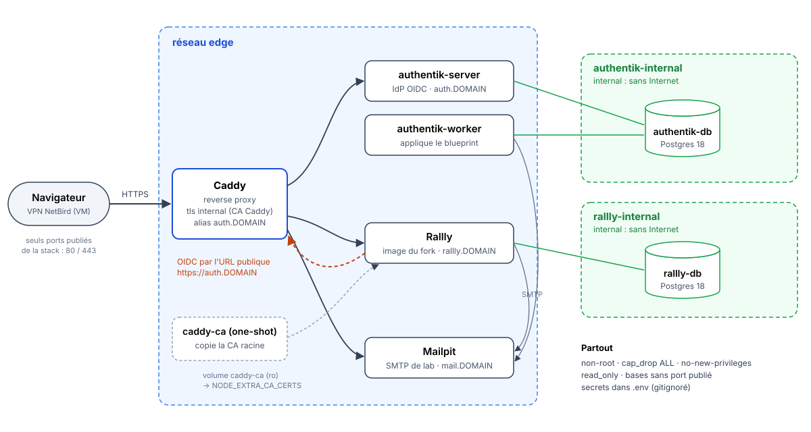
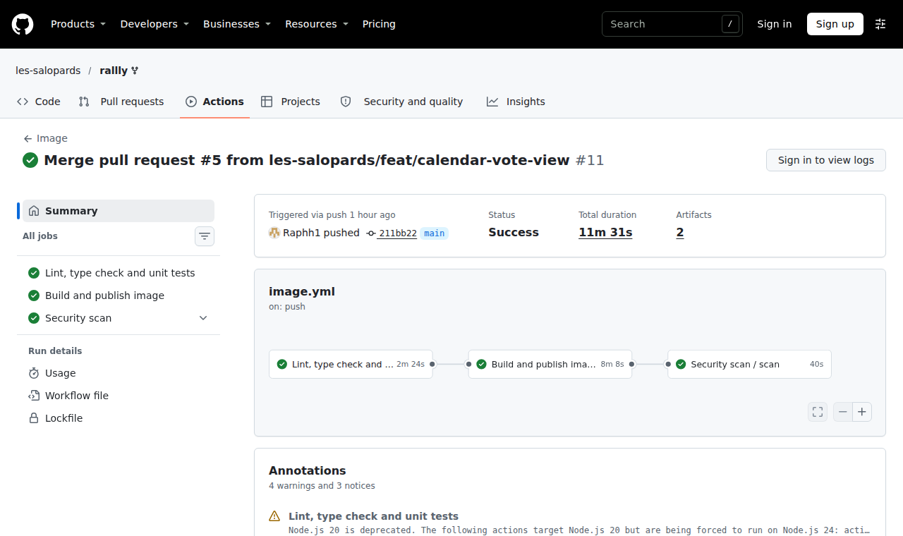
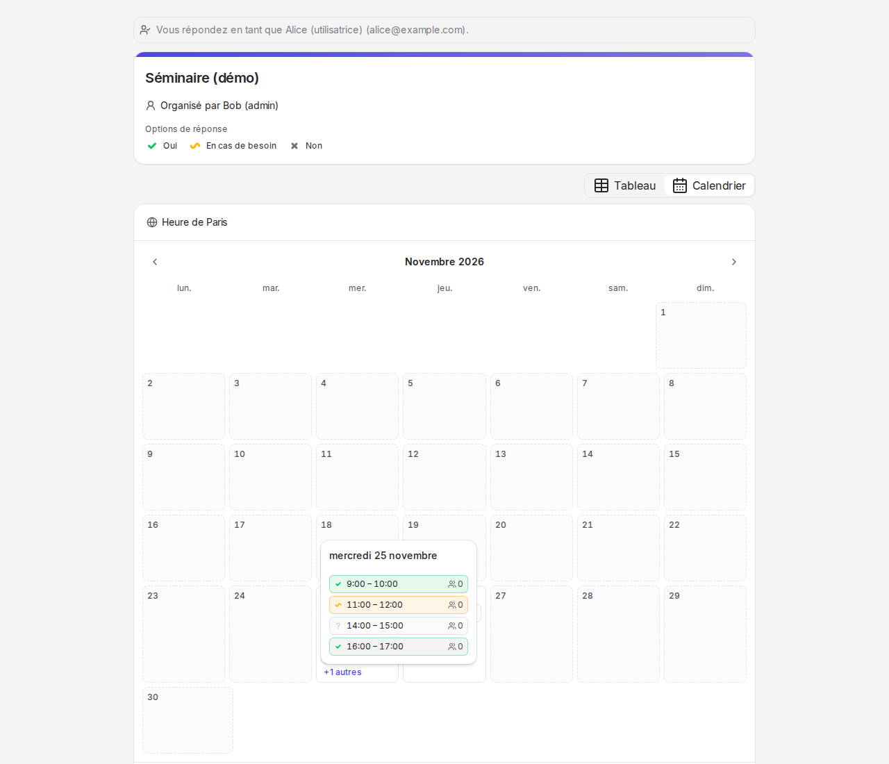
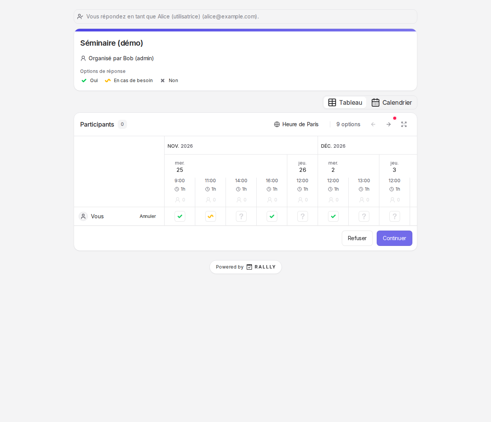

<!-- _class: title -->
<!-- _paginate: false -->

# Rallly derrière Authentik, en local et sur VM

**Module Dev avec Docker — M2 DEVFULLSTACK 2026-2027**

Groupe `les-salopards` : Raphaël · César · Eliott

github.com/les-salopards/projet-infra · github.com/les-salopards/rallly

<!--
15 min au total : ~8 min de slides, ~7 min de démo. Chacun présente sa partie.
Ordre proposé : César (architecture) → Raph (Authentik, feature #1) → Eliott (VM, feature libre) → César (CI/CD, feature #7)
→ Eliott (sécurité).
-->

---

## Ce qu'on a livré

| Critère du sujet (§8) | État |
| --- | --- |
| Stack Compose démarrable depuis le dépôt | ✔ `./scripts/init-env.sh && docker compose up -d --wait` (~1 min 20) |
| Reverse proxy opérationnel | ✔ Caddy, point d'entrée unique, 80/443 seulement |
| SSO Authentik → Rallly | ✔ OIDC, connexion uniquement via Authentik |
| Policies par groupe + invitation externe | ✔ config 100 % déclarative (blueprint) |
| Déploiement VM Énov cohérent avec le local | à faire scripts prêts ; même `compose.yml`, seuls `.env` et `DOMAIN` changent |
| Pipeline CI/CD avec preuve verte | ✔ fork : lint, tests, build, push GHCR, scan · infra : scan de la stack |
| Features | ✔ catalogue #1 + catalogue #7 + feature libre |

<!-- Mettre à jour la colonne État la veille : VM, CI verte (capture), 2e feature catalogue. -->

---

## Architecture

<!--
César.
- Un seul point d'entrée : Caddy. Les bases sont sur des réseaux internal, sans port publié.
- Le piège n°1 : Rallly doit joindre Authentik avec la MÊME URL que le navigateur (l'issuer OIDC doit correspondre).
  D'où l'alias réseau auth.DOMAIN sur Caddy, et la CA de Caddy donnée à Node par le one-shot caddy-ca.
- Volumes : caddy-data (CA), authentik-db, authentik-data, rallly-db.
-->

---

## Authentik : SSO, policies, invitation

- **SSO** : Rallly ne connaît qu'un provider OIDC ; `EMAIL_LOGIN_ENABLED=false`
- **Policies** : `rallly-users` et `rallly-admins` autorisés, tout autre compte refusé **par Authentik**, avant Rallly
- **Invitation externe** : lien à usage unique → inscription → groupe `rallly-users`
- **Tout est dans un blueprint** versionné (`authentik/blueprints/rallly.yaml`) : rien n'est cliqué à la main,
  la même config s'applique en local et sur la VM

| Compte | Groupe | Résultat |
| --- | --- | --- |
| `alice` | `rallly-users` | connectée |
| `bob` | `rallly-admins` | connecté + admin Authentik |
| `charlie` | aucun | *Permission denied* |

<!-- Raph. DÉMO 1 (2 min) : alice se connecte ; charlie refusé ; bob crée une invitation → lien → inscription → Mailpit. -->

---

## Local et VM Énov

| | Local | VM Énov |
| --- | --- | --- |
| `DOMAIN` | `localhost` | `<IP-avec-tirets>.sslip.io` (DNS sans serveur, IP privée) |
| Accès | poste | VPN NetBird |
| Image Rallly | upstream ou fork | **fork, tirée de GHCR** (la VM ne build jamais) |
| TLS | CA interne de Caddy | identique (pas d'IP publique → pas de Let's Encrypt) |
| Secrets | `.env` local | `.env` généré sur la VM, `chmod 600` |

- `deploy/bootstrap-vm.sh` (idempotent) : Docker, utilisateur `deploy`, ufw 22/80/443, SSH par clé, MAJ auto
- `deploy/deploy.sh` : pull → `up --wait` → smoke tests (discovery OIDC, `/api/status`) → ports publiés

<!--
Eliott.
- Redirect URI et NEXT_PUBLIC_BASE_URL sont construits depuis DOMAIN : rien à retoucher en changeant d'environnement.
- Piège : Docker contourne ufw → la vraie protection, c'est de ne publier que 80/443 dans le Compose.
- La démo se fait sur la VM (URL https://rallly.<DOMAIN>).
-->

---

## CI/CD

- **Fork** (`image.yml`) : chaque PR → lint, type-check, tests, build ; `main` → push **GHCR** (`sha-…`, `latest`) puis **scan**
- **projet-infra** : `security-scan.yml` à chaque push et PR (images, règles du Compose, secrets) → appelé aussi par le fork
- **Le scan bloque vraiment** : 3 CVE critiques (Next.js, fast-xml-parser) → corrigées par une PR avant de repasser au vert
- Déploiement : VM joignable seulement par VPN → `deploy.sh` sur la VM tire l'image publiée

<!--
César.
- Une seule chaîne : PR → CI verte → merge → image publiée → la VM tire `latest`. La VM ne build jamais.
- Workflows upstream de Rallly désactivés (Docker Hub, release…) sans supprimer les fichiers : le fork reste propre pour l'upstream.
- Anecdote utile : le premier run sur main était rouge, à cause du scan. On a monté Next.js plutôt que d'ignorer la CVE.
- Montrer l'onglet Actions du fork, puis Packages (image GHCR).
-->

---

## Features

**Catalogue #1 — vote verrouillé par OAuth** (`OIDC_VOTE_REQUIRED=true`)
- sans session OIDC : lecture seule ; avec session : nom et e-mail **imposés par l'IdP, côté serveur**

**Feature libre — sondage réservé à un groupe Authentik**
- l'organisateur saisit un groupe ; seuls ses membres (claim `groups` de l'ID token) peuvent voter
- les autres voient pourquoi (se connecter / « votre compte n'en fait pas partie »)

**Une seule règle « peut voter ? »** partagée par les deux, appliquée dans les actions serveur :
rejouer la requête dans les DevTools → `loginRequired` / `notMember`

<!--
Raph (#1) puis Eliott (feature libre). DÉMO 2 (3 min) :
1. invité → bandeau, pas de formulaire ; requête rejouée → loginRequired
2. alice vote sous son identité IdP
3. sondage réservé à rallly-users, créé par alice : bob → « votre compte n'en fait pas partie » ; le compte invité à la démo 1 → vote OK
-->

---

## Catalogue #7 — vue calendrier pour répondre

 

- Bascule **Tableau / Calendrier** ; grille mensuelle avec les **créneaux horaires dans les cases** (Rallly ne gère que les journées entières, et seulement sur une page expérimentale)
- **Un seul formulaire** pour les deux vues : on vote dans le calendrier, la réponse est déjà dans le tableau
- Même enregistrement, mêmes actions serveur → les verrous de la #1 et de la feature libre s'appliquent tels quels

<!--
César. DÉMO 3 (1 min 30) : alice ouvre le sondage horaire → Calendrier → vote dans la grille, « +1 autres »,
mois suivant → retour au Tableau AVANT d'enregistrer : les votes sont là → Continuer.
Fuseaux : les créneaux sont rangés par jour dans le fuseau du participant (23 h 30 UTC = lendemain à Paris).
22 tests Vitest, relecture indépendante, démo jouée en read_only avec l'image du fork.
-->

---

## Durcissement

Vérifié **dans les conteneurs en marche** (`/proc/1/status`), pas seulement dans le YAML :

| | Caddy | Postgres ×2 | Mailpit | Authentik ×2 | Rallly |
| --- | --- | --- | --- | --- | --- |
| Non-root | 1000 | 70 | 1000 | 1000 | 100 |
| Capacités effectives | 0 | 0 | 0 | 0 | 0 |
| `no-new-privileges` | ✔ | ✔ | ✔ | ✔ | ✔ |
| `read_only` | ✔ | ✔ | ✔ | ✔ | ✔ |

- Chemins inscriptibles trouvés en observant ce que chaque app écrit → tmpfs limités
- `scripts/check-compose.py` fait échouer la CI si une règle saute (`trivy config` ne lit pas le Compose)

<!--
Eliott.
- Seule capacité : NET_BIND_SERVICE pour Caddy (le binaire porte une file capability, sinon "operation not permitted").
- read_only testé avec un vrai parcours : SSO alice/bob, refus charlie, blueprint appliqué, e-mail envoyé.
-->

---

## Scan commenté (Trivy, 17/11)

| Image | CRIT. | Verdict |
| --- | --- | --- |
| Authentik `2026.8.3 → 2026.8.5` | 5 → 1 | montée de version : PyJWT, certifi, anyio corrigés ; `libbrotli1` sans correctif, accepté (VPN) |
| Postgres 18 | 1 | dans `gosu`, jamais exécuté avec `user: postgres` |
| Rallly upstream | 0 | 6 HIGH, toutes dans le CLI `npm` embarqué, pas dans l'app |
| Rallly **fork** (18/11) | 3 → 0 | Next.js 16.3.8 → 16.4.1, `fast-xml-parser` forcé en 5.7 : corrigé, pas ignoré |
| Caddy, Mailpit | 0 | RAS |

- Risques acceptés dans `.trivyignore.yaml`, **limités à un paquet et avec date d'expiration** → la CI repasse au rouge pour réévaluer
- gitleaks sur tout l'historique : aucun secret

<!-- Eliott. 7 CRITICAL au premier scan (6 oct.), 2 aujourd'hui, toutes deux justifiées. -->

---

## Limites assumées

- **TLS interne** : chiffrement réel, mais la CA de Caddy doit être importée (pas d'IP publique)
- **Images tierces épinglées par tag**, pas par digest
- **CVE sans correctif** non listées (`--ignore-unfixed`) ; les HIGH ne bloquent pas la CI, elles sont commentées
- **Déploiement manuel** sur la VM (VPN) ; piste : runner self-hosted
- **Features** : `OIDC_VOTE_REQUIRED` au niveau de l'instance ; groupes rafraîchis à la reconnexion ;
  un compte peut encore ajouter deux réponses

<!-- Eliott. Conclure : l'infra d'abord, reproductible, la même du poste à la VM. -->

---

<!-- _class: title -->

# Questions

Dépôt : github.com/les-salopards/projet-infra — doc : README, docs/authentik.md, docs/vm.md, docs/security.md
