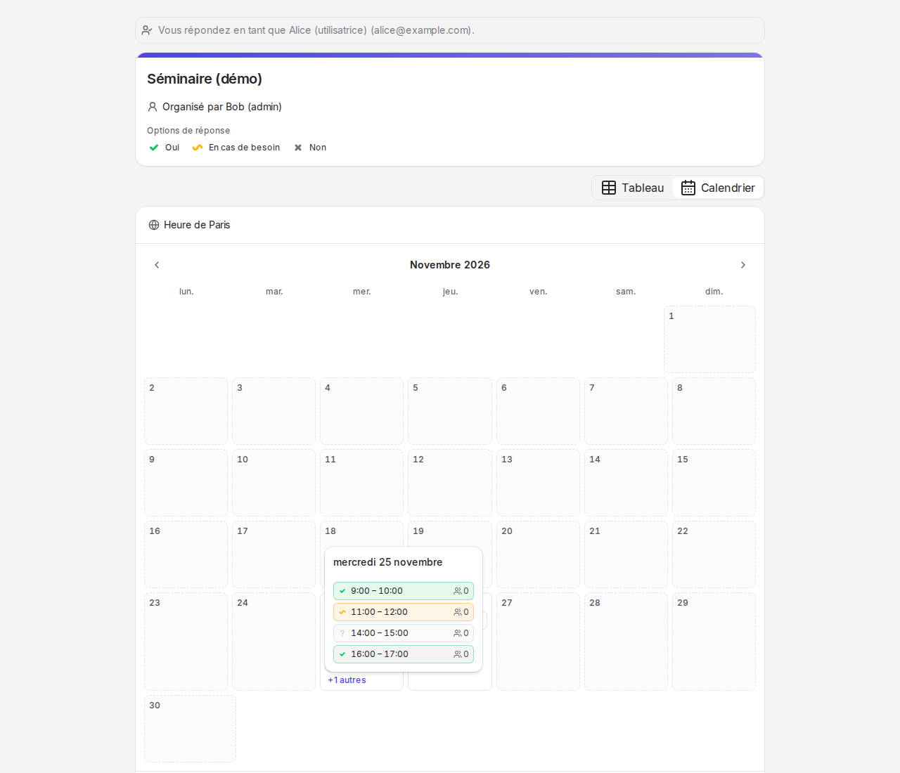
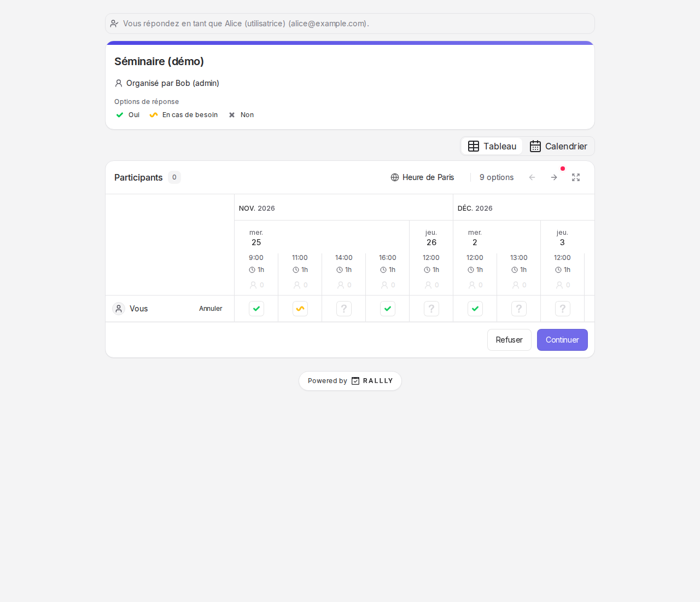
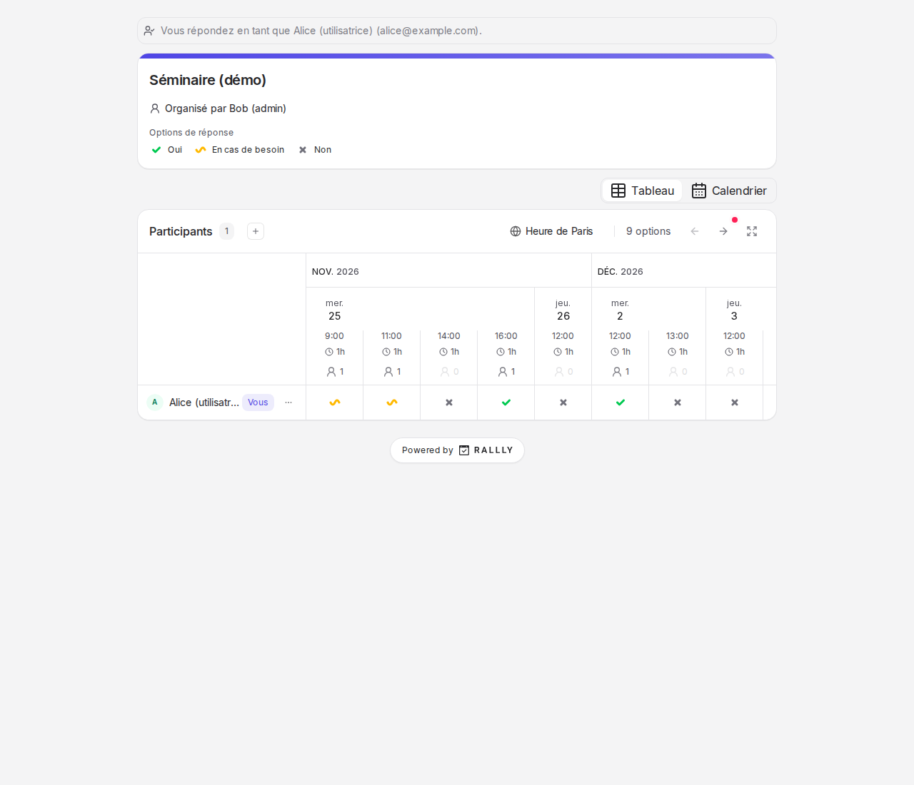

# Feature #7 — Vue calendrier pour répondre

Porteur : César · Branche du fork : `feat/calendar-vote-view` · Catalogue : #7 (issues Rallly #2419, #167) · Spec du 18/11/2026.

## Pourquoi
La note de cadrage a retenu la #7 parce que c'est la feature la plus visuelle en démo. Le moment à réussir devant le jury :
**un participant répond depuis une grille mensuelle, enregistre, puis retrouve sa réponse dans le tableau habituel.**
Le calendrier n'est pas une maquette à côté du sondage : c'est une autre façon de remplir **la même réponse**.

Soutenance le 19/11/2026 : tout ce qui suit doit tenir en une soirée. En cas de dérapage, la parade de la note s'applique :
d'abord la grille en consultation (scores), ensuite la réponse depuis le calendrier ; repli ultime sur la #12.

## Existant (fork, `main` au 18/11)
- **Page de vote réelle** `/invite/[urlId]` (`app/[locale]/invite/[urlId]/invite-page.tsx`) : `VotingForm` (react-hook-form,
  `features/poll/components/voting-form.tsx`) enveloppe `ResponsiveResults`, qui affiche `DesktopPoll` (tableau, ≥ 640 px)
  ou `MobilePoll` (liste groupée par jour). L'état de vote est le tableau `votes[]` du formulaire, aligné sur l'ordre des
  options, et un champ `mode` (`view` / `new` / `edit`).
- **Vue calendrier upstream** (`features/poll/vote/components/vote-view-calendar.tsx`, commit Rallly #3411 du 30/09) :
  uniquement sur la page *preview* `/invite/[urlId]/vote`, avec un autre modèle de données (`VotePageView`), et
  **seulement pour les sondages à journées entières** (les sondages horaires n'y ont qu'une vue semaine).
- Briques réutilisables : `MonthGrid` (`@rallly/ui/month-grid`, sur react-day-picker), `toggleVote` et `VoteSelector`
  (`features/poll/components/vote-selector.tsx`, cycle oui → si besoin → non, sans « si besoin » si
  `allowTentativeVotes` est faux), `VoteIcon`, le regroupement par jour de `mobile-poll/grouped-options.tsx`
  (options déjà converties dans le fuseau du participant via `useOptions`).

## Approches envisagées
| Approche | Pour | Contre | Décision |
| --- | --- | --- | --- |
| **A. Nouvelle vue calendrier sur la page réelle**, branchée sur `VotingForm` | Même état que le tableau (piège cité par la note), règles #1 et feature libre conservées sans rien ajouter, gère les créneaux horaires | Code à écrire | **Retenue** |
| B. Brancher la vue upstream sur la page réelle | Grille déjà dessinée | Adapter `VotePageView` au contexte de la page réelle ; reste limitée aux journées entières : de la plomberie peu visible | Écartée |
| C. Basculer la page preview en page par défaut | Quasi gratuit | Le travail serait celui de Rallly ; verrous #1 et feature libre non vérifiés sur cette page | Écartée |

## Objectifs
1. Une bascule **Tableau / Calendrier** au-dessus des résultats de la page `/invite/[urlId]`. Le tableau reste la vue par défaut.
2. Une **grille mensuelle** avec navigation entre les mois ; elle s'ouvre sur le mois de la première option à venir
   (à défaut, de la première option). Les jours sans option sont grisés.
3. **Créneaux horaires dans les cases** (ce que la vue upstream ne fait pas) : jusqu'à 3 créneaux par case, puis
   « +N autres » qui affiche la liste complète du jour. Journées entières : la case entière porte l'option.
4. **En consultation** (`mode = view`) : chaque créneau affiche son score (nombre de « oui »). Si le visiteur a déjà
   répondu, ses propres votes s'affichent (icône). Pas de sélecteur de participant (le tableau n'en a pas non plus).
5. **En réponse** (`mode = new` ou `edit`) : un clic sur un créneau fait tourner son vote avec `toggleVote`
   (respecte `allowTentativeVotes`) en écrivant dans le `votes[]` de `VotingForm`. Changer de vue en cours de réponse ne
   perd rien.
6. **Contrôles de réponse dans la vue calendrier** (le tableau les porte dans ses lignes, le calendrier doit donc les
   rendre lui-même) :
   - `mode = new` : le calendrier affiche `VotingFooter`, comme `DesktopPoll`. Un visiteur sans réponse (par exemple
     `alice` connectée) arrive déjà dans ce mode : la grille est directement votable.
   - `mode = view` et le visiteur a une réponse : bouton « Modifier ma réponse » qui appelle
     `useVotingForm().setEditingParticipantId(<sa réponse>)`, comme le menu d'une ligne du tableau.
   - `mode = edit` : boutons Enregistrer (soumission du formulaire `VotingForm`) et Annuler (`cancel()`).
   - Aucune nouvelle action serveur : on soumet le même formulaire, donc les mêmes actions et les mêmes verrous.
7. **Fuseaux** : les créneaux sont rangés par jour **dans le fuseau du participant**, avec la même logique que la vue
   mobile (un créneau à 23 h 30 UTC peut tomber le lendemain).
8. **Mobile** (< 640 px) : grille compacte (un point sous les jours qui ont des créneaux) ; un appui sur un jour affiche
   ses créneaux en dessous, avec le même cycle de vote. La vue calendrier rend son propre en-tête minimal (bascule,
   `TimesShownIn`) et les mêmes contrôles que l'objectif 6 : `MobilePoll` n'est pas modifié. Fonctionnel, pas peaufiné :
   la démo se fait sur ordinateur.
9. Textes en anglais et en français (`apps/web/public/locales/{en,fr}/app.json`).

## Hors périmètre
- Aucune modification du modèle de données, des actions serveur ou de l'API.
- Pas de vue semaine, pas de changement de la page *preview* upstream.
- Pas de glisser-déposer ni de sélection multiple.
- La vue choisie n'est pas mémorisée entre deux visites.

## Anti-objectifs (échec même si « ça marche »)
- Un **second état de vote** propre au calendrier, synchronisé à la main avec le tableau.
- Un calendrier qui **contourne** les verrous de la #1 (connexion OIDC) ou de la feature libre (groupe) : il n'a aucun
  chemin d'enregistrement à lui.
- Une régression du tableau ou de la vue mobile existants.

## Contraintes
- Fork Rallly (Next.js, React, react-hook-form, Tailwind, `@rallly/ui`), conventions du dépôt : Biome, `pnpm type-check`,
  tests Vitest (`pnpm test:unit`).
- La CI du fork (`docs/specs/fork-ci.md`) doit être verte sur la PR avant le merge.
- Un `MonthGrid` rend chaque jour dans un `<button>` (react-day-picker) : des boutons de créneau ne peuvent pas y être
  imbriqués. Au constructeur de choisir : rendu de jour non-bouton via les composants de react-day-picker, ou grille
  maison (7 colonnes, mêmes classes). Aucun bouton imbriqué dans un autre.

## Laissé au constructeur
- Découpage en composants et emplacement (proposition : `features/poll/components/calendar-poll/`).
- Forme de la bascule (`VoteSegmentedControl` existant ou boutons simples) et icônes.
- Fonctions pures testées en Vitest : regroupement des options par jour local, choix du mois initial, coupe « 3 + N autres ».

## Scénario de démo (2 min)
Sondage de démo avec des **créneaux horaires** sur deux mois (dont un jour à 4 créneaux), `alice` connectée via Authentik.
1. Ouvrir le sondage (alice n'a pas encore répondu, donc le formulaire est déjà en mode réponse) : tableau habituel,
   puis bascule **Calendrier** → grille du mois, scores sur chaque créneau.
2. Cliquer des créneaux dans la grille (oui, si besoin, non), ouvrir « +1 autres » sur le jour chargé, passer au mois
   suivant et voter encore.
3. Rebasculer sur **Tableau** avant d'enregistrer : les votes sont déjà là. Enregistrer.
4. La ligne d'`alice` apparaît dans le tableau avec ses réponses ; en calendrier, les scores ont bougé.
5. Bonus : en calendrier, « Modifier ma réponse », changer un créneau, enregistrer → le tableau suit.

## Vérification
- Tests Vitest des fonctions pures (dont un créneau qui change de jour selon le fuseau).
- `pnpm type-check`, Biome, CI du fork verte.
- Parcours de démo joué dans la stack `projet-infra` avec l'image du fork (`RALLLY_IMAGE`), captures pour le README.

## Vérifié (18/11/2026)
Code : fork, PR #5 (mergée dans `main`, CI verte). Plan : [docs/plans/2026-11-18-calendar-vote-view.md](../plans/2026-11-18-calendar-vote-view.md).
- **Tests** : 22 tests Vitest dans `features/poll/components/calendar-poll/` (regroupement par jour et fuseaux, dont un
  créneau 23 h 30 UTC rangé le lendemain à Paris ; mois initial ; grille ; cycle de vote avec et sans « si besoin » ;
  scores masqués ; réponse retrouvée par le lien d'édition). Suite `features/poll` : 118/118. Type-check et Biome propres.
- **Relecture indépendante** de toute la branche : aucun point critique ; 2 points importants corrigés avant le merge
  (réglage « masquer les votes » respecté ; une réponse ouverte par son lien d'édition est bien retrouvée, pas de doublon).
- **Démo complète** jouée dans la stack `projet-infra` avec l'image du fork (Rallly en `read_only`), `alice` connectée
  via Authentik, sondage horaire sur deux mois avec un jour à 4 créneaux : vote dans la grille, « +1 autres », mois
  suivant, retour au tableau avant enregistrement (« 4 options sélectionnées », votes présents), Continuer et validation,
  puis « Modifier ma réponse » depuis le calendrier et Sauvegarder : le tableau suit. Aucune erreur dans la console.

| Détail d'un jour chargé | Tableau avant enregistrement | Tableau après modification depuis le calendrier |
| --- | --- | --- |
|  |  |  |

## Limites assumées
- Le premier jour de la semaine suit la langue, pas la préférence de l'utilisateur.
- Le nom accessible d'un créneau ne contient pas la date ; le score n'est pas annoncé comme tel.
- En mode « nouvelle réponse » pour quelqu'un qui a déjà répondu, l'annulation se fait depuis le tableau.
- La bascule apparaît aussi sur la page organisateur (même composant de résultats) ; la vue choisie n'est pas mémorisée.
