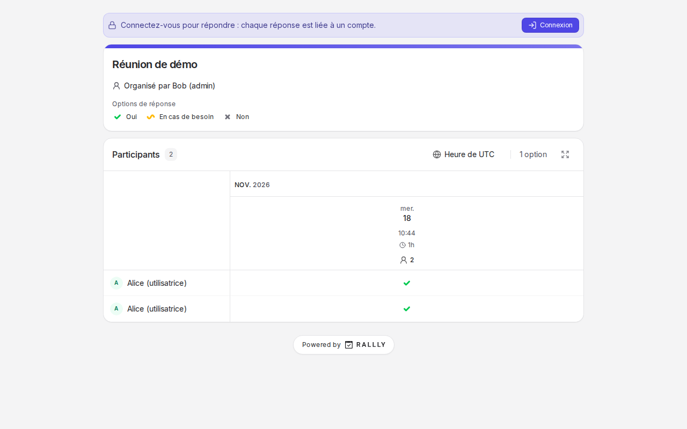
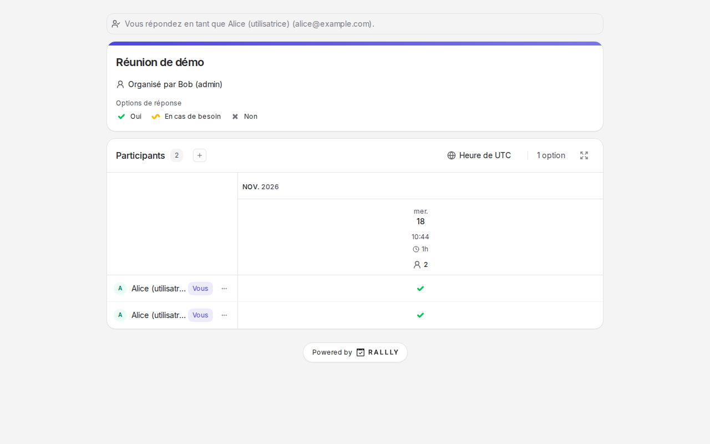

# Feature #1 — Vote verrouillé par OAuth

Porteur : Raph · Branche du fork : `feat/oauth-locked-vote` (construite sur `feat/group-restricted-poll`) · Catalogue : #1 (issues Rallly #1294, #126, #177).

## Problème
Par défaut, n'importe qui ayant le lien d'un sondage vote en invité, sous le nom qu'il veut.
Impossible de savoir qui a réellement voté, ni d'empêcher quelqu'un de voter à la place d'un autre.

## Ce que fait la feature
Activée par `OIDC_VOTE_REQUIRED=true` (désactivée par défaut, comportement upstream inchangé) :
- **Sans session OIDC, vote impossible** : un invité voit le sondage en lecture seule, avec un bandeau
  « Connectez-vous pour répondre » et un bouton de connexion (vers Authentik).
- **Avec session OIDC, l'identité de l'IdP est liée au vote** : le bandeau affiche « Vous répondez en tant que
  Alice (alice@example.com) », les champs nom et e-mail sont en lecture seule et « Changer le nom » disparaît.

## Fonctionnement
| Étape | Où (fork) | Détail |
| --- | --- | --- |
| Règle « peut voter ? » | `features/poll/group-access/` | Une seule règle pour la #1 et la feature libre : `evaluateGroupAccess` prend `oidcRequired`. Sans groupe : invité ou compte sans identité OIDC → `loginRequired`, compte OIDC → `allowed`. Avec groupe : règle d'Eliott inchangée. Les organisateurs passent outre le groupe, pas l'exigence OIDC. |
| Identité | `features/poll/oidc-vote/` | `resolveVoterIdentity` : avec OIDC requis, le nom et l'e-mail envoyés par le client sont **ignorés**. Le serveur prend ceux du compte, que Better Auth a copiés depuis l'IdP. |
| Refus serveur | `features/poll/participant/actions.ts` | `addParticipantAction` et `updateParticipantVotesAction` refusent (`loginRequired`) ; `renameParticipantAction` renvoie `FORBIDDEN`. Un lien d'édition reçu par e-mail ne contourne pas la règle. |
| UI | `group-restriction-banner.tsx`, `new-participant-modal.tsx`, `participant-dropdown.tsx` | Bandeaux, champs verrouillés, renommage masqué (via `identityLocked` dans le contexte du sondage). |

Tests : 7 tests Vitest (`group-access/utils.test.ts`, `oidc-vote/utils.test.ts`).

## Limites assumées
- Réglage au niveau de l'instance, pas par sondage : en démo, tous les sondages exigent un compte.
- Les votes déjà enregistrés en invité avant activation restent tels quels.
- L'identité est celle de la dernière connexion : un changement de nom dans Authentik s'applique aux réponses suivantes.
- Un même compte peut encore ajouter plusieurs réponses (bouton « + » de Rallly) : chacune porte son identité IdP,
  donc c'est visible, mais pas bloqué. Piste : refuser une 2e réponse du même `userId` dans `addParticipantAction`.

## Vérifié (16/11/2026, image du fork, stack locale)
- Appel direct de l'action de vote en invité → `{"ok":false,"reason":"loginRequired"}`.
- Appel en `alice` avec `name: "Faux nom"`, `email: "faux@example.com"` → réponse enregistrée sous
  `Alice (utilisatrice)` / `alice@example.com`, liée à son compte.
- Renommage en `alice` → `FORBIDDEN`.

| Non connecté | Connectée via Authentik |
| --- | --- |
|  |  |

## Scénario de démo (2 min)
1. Navigation privée, lien d'un sondage → bandeau « Connectez-vous pour répondre », pas de formulaire de vote.
2. Preuve serveur : rejouer la requête de vote d'un invité (DevTools → requête copiée) → refus `loginRequired`.
3. Bouton de connexion → Authentik → `alice` → retour sur le sondage : « Vous répondez en tant que Alice (utilisatrice) (alice@example.com) ».
4. Voter : nom et e-mail pré-remplis et non modifiables. Dans la liste, la réponse porte le nom IdP.
   Côté organisateur, le menu de la réponse affiche aussi l'e-mail.
